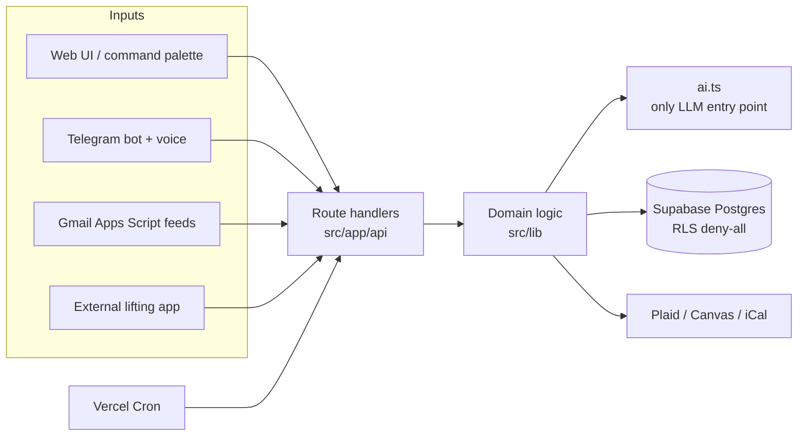

# Personal OS

A single-user life dashboard I built and use every day: school, tasks, calendar, money, goals,
journal, fitness and a startup inbox in one Next.js app, with an AI assistant that reads all of it
and suggests what to do next. Capture works from anywhere — the web, a command palette, or a
Telegram bot that also takes voice notes.

This is the public edition of my private repo. The code is the same; my personal data, seed
files and two private modules are not included (see [What's not here](#whats-not-here)).

## Highlights

- **18 boards, 84 API routes, ~27k lines of TypeScript**, built in waves from written specs with
  AI coding agents (Claude Code), then reviewed and hardened.
- **Capture engine.** One input box (or a Telegram message, or a voice note) is classified by
  Claude → OpenAI → a regex fallback into up to five routed items — task, event, journal entry,
  plan milestone, application, reading-list book — with dates and times grounded against the
  source text so a model can't silently drop "Friday at 3".
- **Privacy guardrails enforced by tests, not by convention.** Private journal entries, the
  advisor-only academic record and the private tier of the assistant's knowledge base are kept
  out of Home, résumés, exports and public AI prompts. Unit tests read the import graph and
  fail the build if a module that renders or exports data starts reading a private source.
- **One LLM chokepoint.** `src/lib/ai.ts` is the only file allowed to import an LLM SDK; a test
  pins the allowlist of modules that may call it. Timeouts, retries, model tiers and tolerant
  JSON extraction live in one place.
- **Money cockpit.** Plaid account sync with per-item fault isolation and a reconnect flow,
  encrypted access tokens, spending categories with overrides and budgets, net worth behind a
  PIN, and a wish list gated by a monthly cap.
- **School HQ.** Canvas LMS sync, syllabus-derived course metadata, and a dated "runway" of
  graded work. A lock-in mode turns the front page into an exam countdown with daily
  non-negotiables and a streak.
- **Daily rhythm.** An editable routine merged with work shifts into a per-day timeline; the bot
  pings before focus blocks and asks how they went afterwards.
- **Ops.** Vercel Cron for the morning briefing, reminders and nudges; backups to a private
  storage bucket with private data redacted at the source; a capture-audit view for debugging.

## Stack

Next.js 15 (App Router) · React 19 · TypeScript · Tailwind 4 · Supabase (Postgres) · Plaid ·
Anthropic + OpenAI · Telegram Bot API · Vitest + Playwright · deployed on Vercel.

## Architecture



Route handlers are thin: validate, then call a `src/lib` module. Every table has row-level
security enabled with no policies, so client roles can't read anything; only the server's
service-role key can. **[ARCHITECTURE.md](ARCHITECTURE.md)** is a one-page map of every route,
module, the auth model and the background jobs.

## Run it

You need Node 20+, a Supabase project, and at minimum the "Required" block of `.env.example`.
Every integration (Plaid, Canvas, Telegram, AI) is optional; its tab degrades gracefully.

```bash
npm install
cp .env.example .env.local        # fill in the required values

# create the schema, then (optionally) load the fictional demo data
for f in supabase/migrations/*.sql; do node scripts/apply-migration.mjs "$f"; done
node scripts/apply-migration.mjs supabase/seed/demo.sql

npm run dev                       # http://localhost:3000, log in with DASHBOARD_PASSWORD
```

```bash
npm run lint
npm run test:unit    # vitest — 240 tests, including the privacy guardrails
npm run test:e2e     # playwright — needs a running app and .env.local
npm run build
```

## Layout

| Path | What's in it |
|---|---|
| `src/app/(dashboard)/` | One page per tab; each is a thin wrapper around a Board component |
| `src/app/api/` | Route handlers — validate, then call a `src/lib` module |
| `src/lib/` | Where the logic lives |
| `src/components/dashboard/` | The Board components |
| `src/components/ui/` | Primitives — Panel, Ring, Tag, CountUp, Marquee… |
| `supabase/migrations/` | Schema, applied in order with `scripts/apply-migration.mjs` |
| `supabase/seed/demo.sql` | A fictional student, for trying the app |
| `tests/unit`, `tests/e2e` | Vitest and Playwright |
| `design/` | Design-system bundle and the HTML prototypes the UI started from |
| `scripts/` | Migration runner and the Gmail → dashboard Apps Script forwarders |

## The guardrails

Each is a unit test that fails if the rule is broken:

- **Private journal** — private entries and the personal space never reach the public Reflect
  feed, memory search, or the nudge engine (`privacy.test.ts`).
- **Academic record** — advisor-only; consumed by the nudge engine for realism, never rendered,
  never in a résumé, briefing or export (`academicPrivacy.test.ts`).
- **Knowledge base** — two tiers; private items reach only the advisor and the private Q&A, never
  Home, résumés, public nudges or backups (`knowledgeBasePrivacy.test.ts`).
- **LLM access** — only `src/lib/ai.ts` imports an LLM SDK (`llmGuardrail.test.ts`).
- **Backups** — every table created by a migration is in the backup list
  (`backupTables.test.ts`), and private columns are redacted at the source.

## Fitness ingest

An external app can push workouts with `POST /api/fitness/workouts` and
`Authorization: Bearer $FITNESS_INGEST_SECRET`. The body is one workout or
`{"workouts": [...]}` (max 100). Each needs `external_id` (the idempotency key — re-sending
updates in place), `name` and `performed_at`; `type`, `duration_min`, `notes`, `source` and a
free-form `data` object are optional. Responses: `200 {"ok": true, "upserted": N}`, `400` on
validation errors (nothing written), `401` on a bad bearer.

## What's not here

The private repo also has a health log and a PIN-locked journaling space, plus my real profile,
CV, applications and knowledge base as seed data. Those are personal, so this edition leaves
them out; the remaining code builds and passes its tests without them.

## Status

In daily use since mid-2026. Single-user by design — there's one password and no sign-up.
